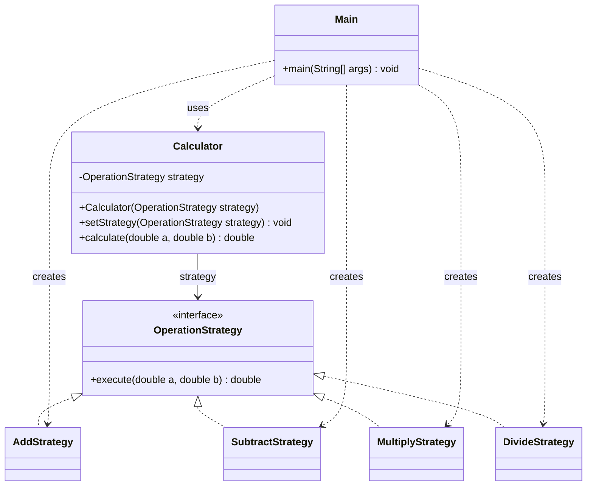

# Assignment 5 - Strategy Pattern

Samarin Maxim

## 1. Introduction

The chosen topic is a calculator (Option B). The algorithm family is basic
arithmetic: addition, subtraction, multiplication and division. Each
operation is a separate class that implements `OperationStrategy`.

`Calculator` stores the selected strategy. `Main` creates one calculator
and changes its operation while the program is running.

## 2. UML class diagram



`Calculator` is the Context, `OperationStrategy` is the Strategy interface,
the four operation classes are Concrete Strategies, and `Main` is the Client.

## 3. Clean Code

### 1. Replace operation conditionals with polymorphism

A calculator without Strategy could choose operations like this:

```java
if (operation.equals("add")) {
    return a + b;
} else if (operation.equals("subtract")) {
    return a - b;
}
```

In this project, `Calculator.calculate` only delegates:

```java
public double calculate(double a, double b) {
    return strategy.execute(a, b);
}
```

The selected object decides which calculation runs. There is no
`if` or `switch` on the operation type inside `Calculator`.

### 2. Use meaningful names

```java
calculator.setStrategy(new SubtractStrategy());
```

`SubtractStrategy` tells us which operation will run. `setStrategy`
shows that the calculator's current operation is being changed.

### 3. Give each class one responsibility

```java
public class AddStrategy implements OperationStrategy {
    @Override
    public double execute(double a, double b) {
        return a + b;
    }
}
```

`AddStrategy` only adds two numbers. It does not read input or print output.
The other strategies follow the same structure. Printing belongs to `Main`.

### 4. Keep the context independent of concrete algorithms

```java
private OperationStrategy strategy;

public Calculator(OperationStrategy strategy) {
    this.strategy = strategy;
}
```

The field and constructor use the interface. `Calculator` does not refer
to `AddStrategy`, `DivideStrategy` or any other concrete operation.
It only needs an object that provides `execute`.

### 5. Extend behavior without changing existing algorithms

Division was added after the first three operations. The new class
implements the same interface:

```java
public class DivideStrategy implements OperationStrategy {
    @Override
    public double execute(double a, double b) {
        if (b == 0) {
            throw new IllegalArgumentException("Cannot divide by zero");
        }
        return a / b;
    }
}
```

The client selects it with:

```java
calculator.setStrategy(new DivideStrategy());
```

Only the new class and `Main` were changed. `Calculator`, the interface
and the first three strategies did not need changes. The zero check
validates the divisor; it does not select an operation type.

## 4. Strategy vs. State

Strategy fits because the client chooses between interchangeable
algorithms. The calculator is not moving through a lifecycle; it is just
using a different operation on the same inputs. State is used when an
object's behavior depends on its current state, for example a document
being a draft or published. State often includes transitions between
states. Here, `Main` explicitly chooses the next strategy.

## 5. Conclusion

The calculator can switch operations without creating a new context.
Adding an operation requires a new strategy and a change in the client,
while the calculator itself stays the same. This adds several small
classes, which is more code than a simple calculator needs, but makes
the separate operations and the Strategy pattern easy to see.

The project was compiled with JDK 17. Checks covered the four operations,
negative and fractional numbers, zero, division by zero, switching back
to an earlier strategy, and using an extra strategy without changing
`Calculator`.

## 6. GitHub repository

https://github.com/sannder01/ass5_sdp

References and assistance:

- Assignment 5 handout: *Strategy Pattern, 2026-2027*, Astana IT University.
- OpenAI ChatGPT: assistance with the code example, report and explanations.
  https://chatgpt.com/
